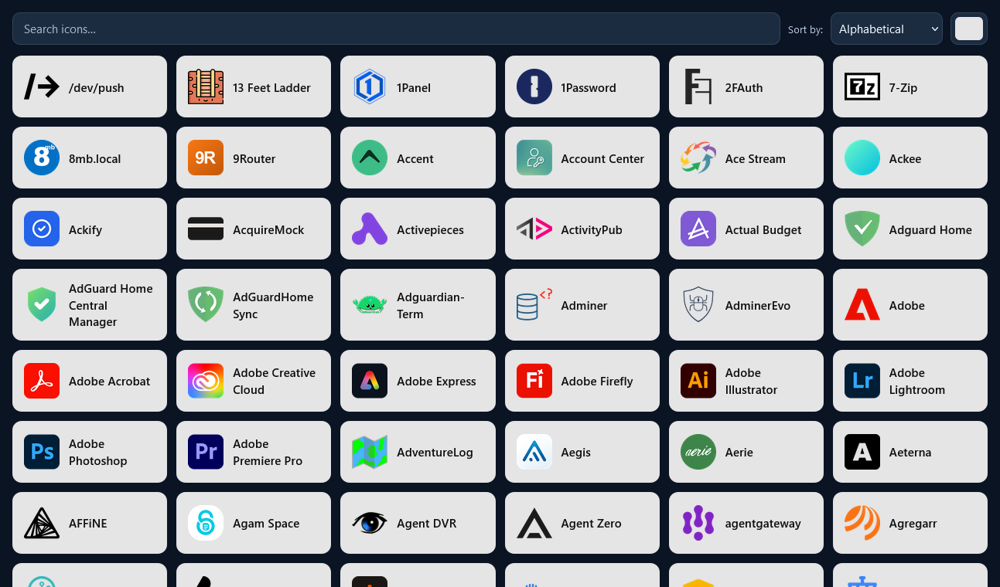
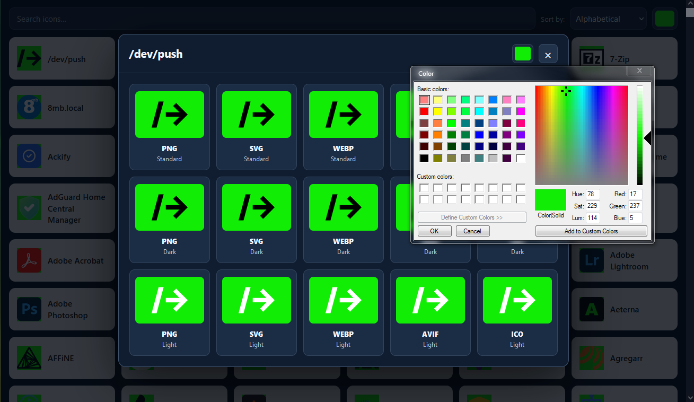

# GitHub repositories are now mirror only

Due to recent changes in GitHub's direction, development has migrated to: https://git.ribas89.co.uk/

Have a issue/question? https://link.ribas89.co.uk/ask


Thank you for your support ❤️!

# selfhst front

A minimal frontend for the existing selfh.st/icons Go server. Both binaries run in **one** container. All changes to the gallery are under `./icons/front`; upstream icon files and Go sources stay under `./icons/build`.

You will need https://github.com/selfhst/icons for this, put in the build folder.

Check the [compose-example.yml](./compose-example.yml) for more info.

## Directory layout

```
icons/
  build/                    # Original repository
    svg/ png/ webp/ avif/ ico/
    index.json index-consolidated.json tags.json
    build/main.go
    build/go.mod
  front/                    # Custom frontend
    Dockerfile
    Dockerfile.dockerignore
    entrypoint.sh
    go.mod
    main.go
    static/index.html
    static/app.css
    static/app.js
```

## Screenshots


